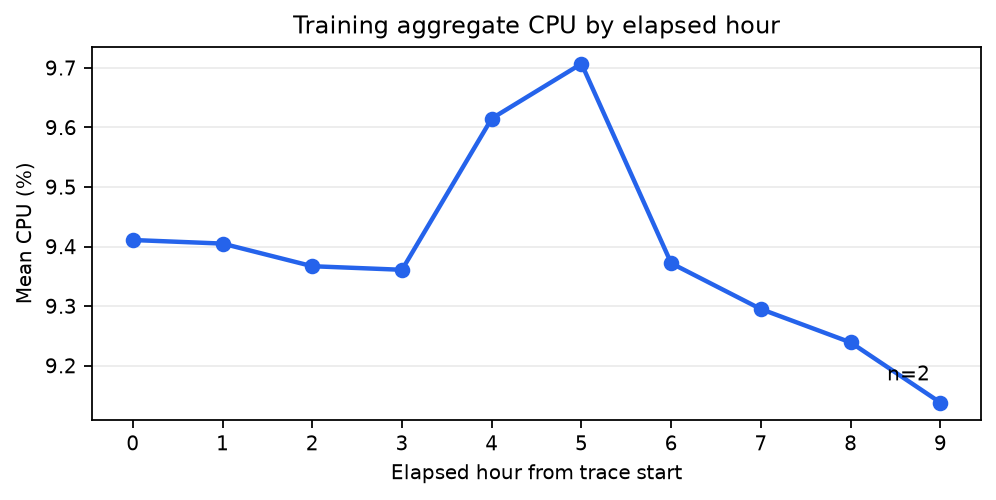
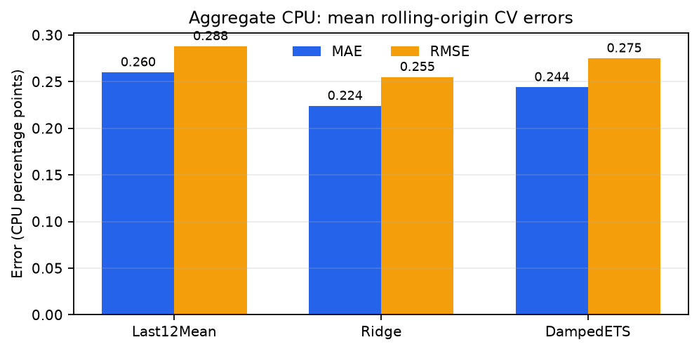
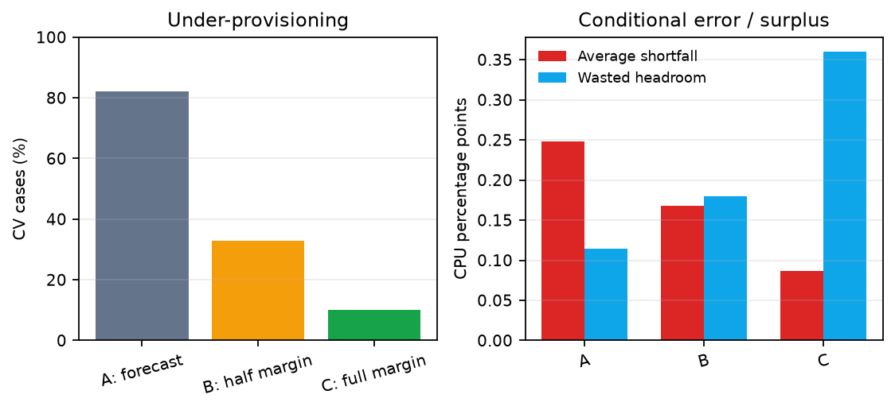

# Cloud Workload Forecasting & Capacity Planning

## 1. Executive summary

This report evaluates short-horizon forecasts for two aggregate workload targets built from the Azure VM trace: `active_vm_count` and `aggregate_cpu_utilization`. The supplied series is sampled every five minutes. The forecasting protocol uses the first 110 timestamps for training and model selection, then reserves the final 24 timestamps as a two-hour public holdout. Raw timestamps are retained for output; a separate UTC datetime is used to order and model observations. Because source timestamps are seconds relative to the trace, their UTC conversion is a modeling convenience rather than actual workload wall-clock time.

The model comparison is deliberately small: a last-12-observation moving-average baseline, Ridge regression on lagged target history, and damped exponential smoothing (ETS). Rolling-origin cross-validation (CV) is confined to the 110-point training partition. For aggregate CPU, Ridge has the lowest mean CV MAE (0.224 percentage points) among the three candidates, compared with 0.260 for Last12Mean and 0.244 for DampedETS. Ridge clears the 3% CV improvement threshold over the baseline and is therefore selected.

The final holdout check was run once, after model and policy selection. CPU Ridge scored MAE 0.3012 and RMSE 0.3604, while Last12Mean scored 0.1230 and 0.1613, respectively. These results are recorded as a final evaluation and were not used to retune the model, policy, or parameters. For operational planning, the full upper-interval-margin policy is recommended when avoiding CPU shortfalls is the priority: on CV it under-provisioned 10.12% of cases, versus 82.14% for forecast-only provisioning, but left more wasted headroom. The limited trace, observable peak under-forecasting, and final holdout result all argue for treating this as a reproducible baseline and not a production capacity guarantee.

## 2. Data understanding and preprocessing

The challenge release contains VM-level five-minute CPU readings and VM metadata. The target builder groups readings by raw timestamp, counts distinct VM IDs with valid CPU observations, and averages their `avg_cpu` values to form `aggregate_cpu_utilization`. Null timestamps, VM IDs, or CPU values are excluded from target construction. The aggregate target table preserves the original timestamp and adds a separate UTC `datetime` field. CPU-summary metadata fields (`max_cpu`, `avg_cpu`, and `p95_max_cpu`) are not used as predictors.

All reported training analysis and model selection use the first 110 target timestamps. The final 24 timestamp values are reserved for the holdout. The training timestamps span raw seconds 0 through 32,700, at a constant 300-second cadence, with no gaps or duplicate aggregate timestamps. The training readings contain 1,100,000 VM-level rows; no missing timestamps, VM IDs, or `avg_cpu` readings, no duplicate `(timestamp, vm_id)` pairs, and no training `avg_cpu` values outside the documented 0–100 range were reported.

Within the 110-point training window, `active_vm_count` is constant at 10,000. This is a survivorship effect of the observed cohort: the selected VMs are represented throughout the observed training interval, so this target evaluates persistence of this panel and does not establish that a broader cloud fleet has no arrivals or departures.

## 3. Workload analysis

### Aggregate level and temporal behavior

Training-period aggregate CPU averages 9.414%, has a standard deviation of 0.194 percentage points, and ranges from 9.112% to 9.912%. Its trailing one-hour mean declines from 9.411% at the first complete window to 9.216% at the last training timestamp. This is a modest trend over a short observation period, not evidence of a long-run decline. The local maximum is 9.912% at raw timestamp 16,500 seconds, with high values around raw timestamps 16,500–20,400 seconds.

**Operational implication:** Short-term aggregate demand is relatively stable, but the observed decline and local high period show why a single level estimate can miss transitions. A safety margin should be assessed against time-aware validation rather than inferred from one chart.

The training interval is about nine hours. Elapsed-hour means rise from 9.361% in hour 3 to 9.707% in hour 5 and then decline; hour 9 has a mean of 9.138% based on only two observations. Only one source-relative weekday is represented, and lag-1-hour and lag-2-hour autocorrelations are 0.367 and -0.026. These summaries do not establish repeating daily or weekly seasonality.

**Operational implication:** Hourly changes can inform near-term monitoring, but the partial final hour and lack of repeated days make calendar scheduling or seasonal capacity rules unsupported.

### VM-level variation and segments

The VM-level training readings are much more dispersed than the aggregate series. Their mean is 9.414%, median 5.120%, 75th percentile 9.648%, 95th percentile 37.293%, and maximum 99.488%. A total of 4,635 VMs (46.35%) have mean CPU below 5%, while 220 (2.20%) have mean CPU above 50%. Thus aggregate stability hides substantial differences between VM-level workloads.

**Operational implication:** Aggregate CPU is suitable for the required overall forecast, but it should not be mistaken for uniform utilization across machines. The low-utilization mass and high individual observations suggest that segment-level monitoring could help identify where aggregate headroom is concentrated.

By workload category, Interactive VMs average 11.505% CPU and contribute 37.776% of summed CPU readings; Delay-insensitive VMs average 8.257% and contribute 54.206%; Unknown VMs average 10.355% and contribute 8.018%. The 2-core bucket accounts for 78.142% of summed CPU readings, while the 24-core bucket has the highest mean at 11.429% but contains 62 VMs. The 2-GB memory bucket contributes 36.503%; the 4-GB bucket has the highest mean among larger groups at 11.460%.

**Operational implication:** Capacity decisions should account for both intensity and segment size. A high average in a small group is not equivalent to a large contribution to total demand; low-count buckets are also less stable. These contributions describe shares of summed CPU readings, not shares of provisioned capacity.

## 4. Forecasting approach

The three candidates share the same target-specific forecasting and validation path:

1. **Last12Mean baseline:** the average of the most recent 12 observed target values, corresponding to one hour at the supplied five-minute cadence.
2. **Ridge:** a regularized linear model using target history only. Predictors use lags 1, 2, and 6 and trailing mean/standard deviation summaries over 3, 6, and 12 observations. Multi-step forecasts are recursive: each prediction is appended to the history for the next step.
3. **Damped ETS:** damped exponential smoothing from statsmodels, fit to the training history and used to forecast the requested horizon.

No metadata CPU summaries are used as model inputs. The implementation uses each target's training series and future timestamp template; future target values are not provided to the forecasters. Count forecasts are constrained to be nonnegative and CPU forecasts are clipped to `[0,100]`.

The winner is chosen from CV results by mean MAE. Ridge or DampedETS must improve on Last12Mean by at least 3%; otherwise the baseline is retained. If the two model candidates tie, the simpler candidate is preferred (DampedETS over Ridge). The rule is applied independently to each target, rather than hard-coding a final model choice.

## 5. Validation methodology

The evaluator uses expanding rolling-origin CV inside the 110-point training partition. Each fold begins with at least 50 training observations, forecasts the next 24 timestamps, and advances its origin by six timestamps. This produces seven folds. Validation windows overlap, so the resulting 168 forecast cases per target are not 168 unique timestamps.

This design preserves chronology and approximates repeated operational forecast origins: at each origin, the model sees the history that would have been available then and forecasts the next two hours. It avoids random shuffling, which would expose future regimes to training and make evaluation less representative of deployment. Most importantly, the final 24 target values are never used in these folds, feature construction, model selection, or fitting.

Per-fold and mean MAE and RMSE are reported. The report uses percentage-point CPU errors, not relative percentages. The final holdout is scored only after model and policy choices are fixed. The documented analysis does not provide fold-level numeric model-score tables for every candidate beyond their aggregate means; no additional values are inferred here.

## 6. Results versus baseline

The table gives mean rolling-origin CV scores from the training partition. Lower is better.

| Target | Candidate | Mean CV MAE | Mean CV RMSE |
|---|---|---:|---:|
| `active_vm_count` | Last12Mean | 0.000 | 0.000 |
| `active_vm_count` | Ridge | 0.000 | 0.000 |
| `active_vm_count` | DampedETS | 0.000 | 0.000 |
| `aggregate_cpu_utilization` | Last12Mean | 0.260 | 0.288 |
| `aggregate_cpu_utilization` | Ridge | 0.224 | 0.255 |
| `aggregate_cpu_utilization` | DampedETS | 0.244 | 0.275 |

Ridge is selected for CPU because it has the lowest mean CV MAE and improves over the baseline by more than the required 3%. The difference is modest in absolute CPU percentage points, and the model is not uniformly best on the later holdout.

### Final holdout check (run once)

After selection, each chosen model was fit using the first 110 points and forecast the final 24 timestamps. The holdout actuals were used only to calculate this final check. No model, policy, or parameter was changed after reviewing these figures.

| Target | Selected model | Selected MAE | Selected RMSE | Baseline | Baseline MAE | Baseline RMSE |
|---|---|---:|---:|---|---:|---:|
| `active_vm_count` | Last12Mean | 0.0000 | 0.0000 | Last12Mean | 0.0000 | 0.0000 |
| `aggregate_cpu_utilization` | Ridge | 0.3012 | 0.3604 | Last12Mean | 0.1230 | 0.1613 |

On this one holdout, CPU Ridge is worse than Last12Mean. This contrasts with the training-only CV ranking and is an important limitation of the result, not a basis for post-hoc retuning. The complete 24 raw timestamps, point predictions, and interval bounds are recorded in `notes.md`.

## 7. Error and failure analysis

The CPU peak threshold is the 90th percentile of the training series, 9.6684%. Across the overlapping CV forecasts, 27 cases are peaks and 141 are non-peaks. Peak MAE/RMSE are 0.4104/0.4611, compared with 0.1885/0.2279 for non-peaks. Mean signed error (`actual − forecast`) is +0.4104 for peaks and +0.1400 for non-peaks. Positive bias means the selected model tends to under-forecast, particularly during higher CPU observations.

The worst CV folds by MAE are Fold 1 (0.4148), Fold 2 (0.3296), and Fold 3 (0.2523). In Fold 1, actual CPU rises into a sustained high period near 9.91%, while Ridge remains around 9.2–9.4%, consistent with under-response to the rise. In Fold 2, recursive Ridge drifts downward while actual CPU remains elevated, then actual CPU drops late in the window; the forecast misses both the level and transition. These observations describe likely explanations, not causal diagnoses.

**Operational implication:** If the forecast is used for capacity planning, peak error deserves more attention than the overall CV average. The positive bias and weaker early folds support including a safety margin and monitoring for changes in level; this evidence does not justify a separate peak model.

The optional horizon-step analysis found MAE of 0.1092 at step 2 and 0.3798 at step 16, the lowest and highest values respectively. The pattern is irregular rather than steadily increasing with horizon, so a simple horizon-dependent error assumption is not supported by this short trace.

## 8. Capacity-planning recommendation

The capacity comparison uses the selected Ridge model's CPU CV forecasts and the pooled 90th-percentile residual as the upper 80% interval margin (0.4984 percentage points). It evaluates exactly three policies: A, provision at the forecast; B, forecast plus half the margin; and C, forecast plus the full margin. Under-provisioning is the share of cases where actual exceeds provision. Average shortfall is computed only on under-provisioned cases; wasted headroom is computed only where provision meets or exceeds actual.

| Policy | Under-provisioning rate | Average shortfall | Wasted headroom |
|---|---:|---:|---:|
| A: forecast | 82.14% | 0.2481 | 0.1139 |
| B: forecast + half margin | 32.74% | 0.1679 | 0.1795 |
| C: forecast + full margin | 10.12% | 0.0868 | 0.3601 |

**Recommendation:** Use Policy C when avoiding CPU shortfalls is the priority: it has the lowest CV under-provisioning rate and average shortfall. Its trade-off is the largest wasted headroom, so Policy B is a reasonable compromise if spare capacity is costly relative to the increased shortfall risk. On the one-time holdout, Policy C under-provisioned 6 of 24 points (25.00%); wasted headroom averaged 0.3151 percentage points on the 18 adequately provisioned points. This holdout result is reported for transparency and did not influence the recommendation or parameters.

## 9. Limitations and future work

The study observes only about nine hours of training data. It cannot establish daily or weekly seasonality, and source-relative timestamps do not anchor workload to actual local clock time. The CV folds overlap, the trace has a single cohort, and some metadata segments have small populations. CV favors Ridge for CPU, but the one-time holdout favors the simple baseline; results should therefore be treated as evidence from this trace rather than a general performance guarantee. Exact normalized-MAE and sMAPE comparison values are not included in the documented focused three-candidate results, so none are reported here.

The constant `active_vm_count` of 10,000 throughout training is a survivorship effect of the observed cohort. It means this sample provides no training variation with which to validate changing fleet size; broader conclusions about VM churn or a changing production fleet require data that represents arrivals, departures, and changing membership.

Next work should validate the same leakage-safe design on longer traces and additional forecast origins, investigate whether the cohort is representative of the operational fleet, and re-evaluate the safety-margin trade-off when more observations are available. Any extension should continue to keep holdout labels out of selection and tuning, and should compare against the existing baseline before adding complexity.

---

All reported numerical findings in this report are taken from `notes.md`. Figures are visualizations of those documented values; no additional measurements or holdout analysis were introduced.
